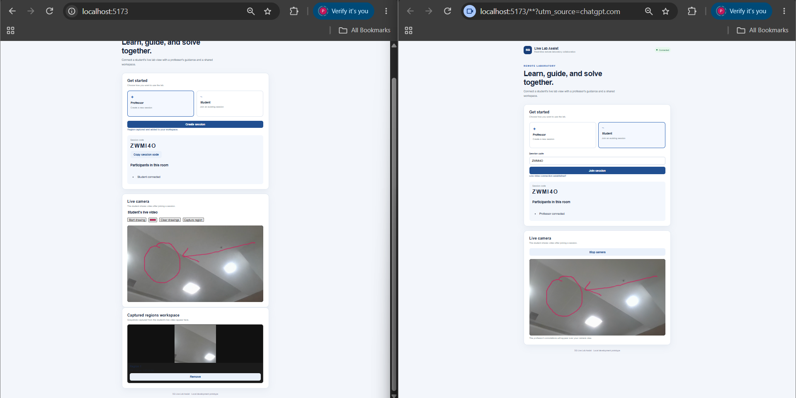
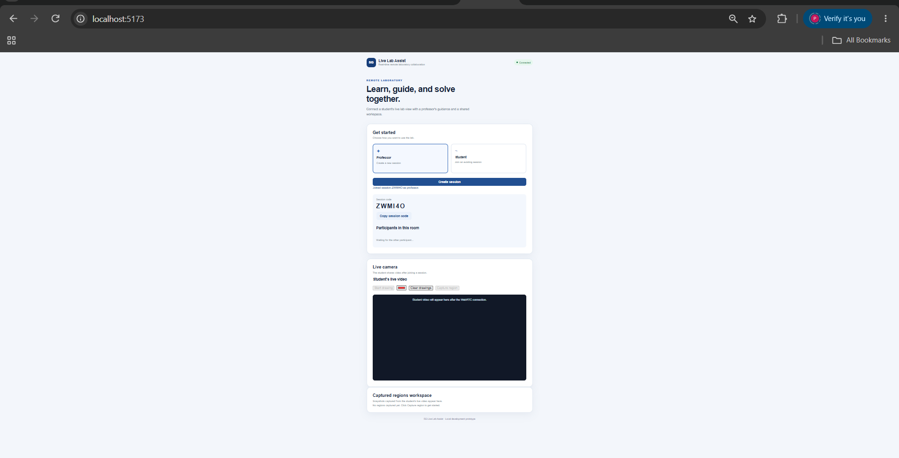
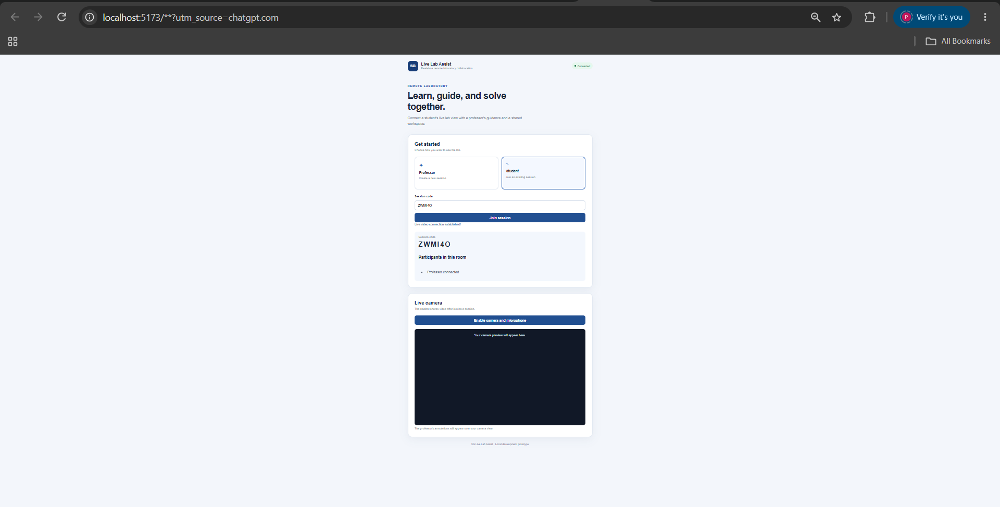
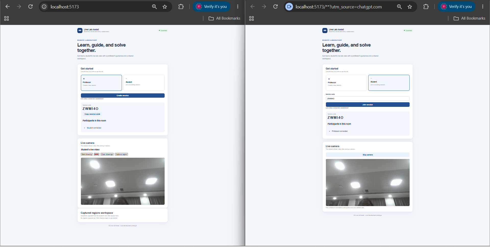
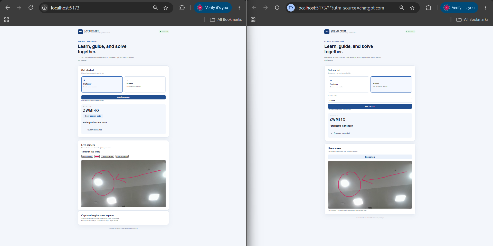
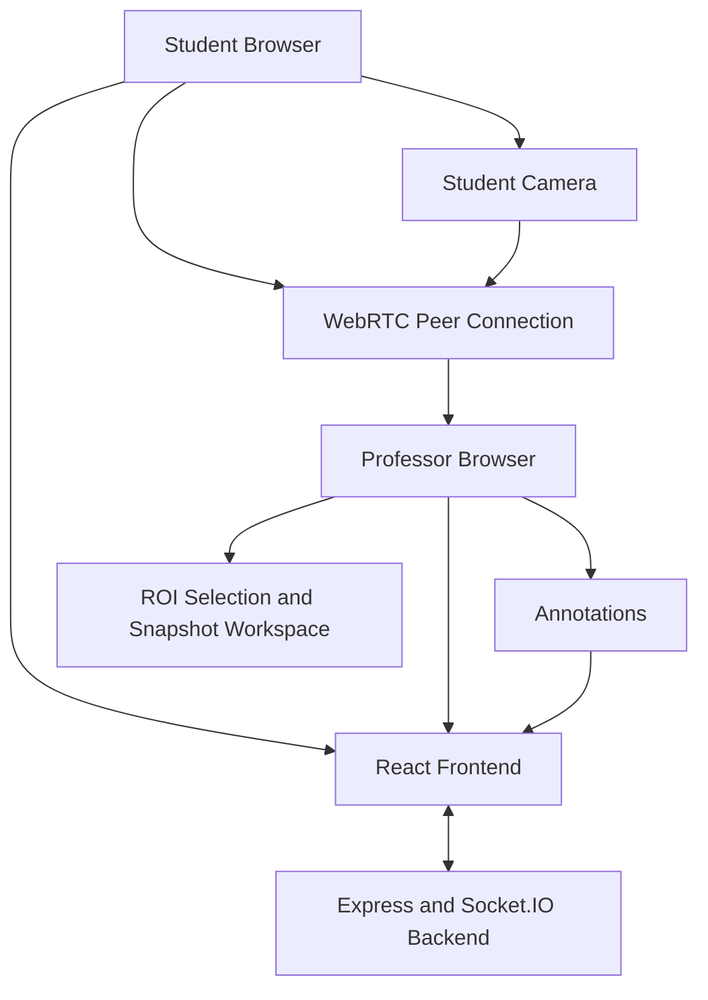

# 5G Live Lab Assist

A real-time remote laboratory collaboration platform that connects students and professors through live video streaming, interactive annotations, and a shared workspace.

## About the Project

5G Live Lab Assist aims to make remote laboratory sessions more interactive and accessible. Students can share their live laboratory setup using a camera, while professors can observe experiments, provide visual guidance, and capture important regions.

## Project Demo



## Key Features

- **Session Management:** Professors create sessions and students join using a unique session code.
- **Live Video Streaming:** Students share their camera feed with professors.
- **Real-Time Annotations:** Professors draw on the live video to guide students.
- **Region of Interest (ROI):** Select and crop specific regions from the video.
- **Snapshot Capture:** Capture important experiment details.
- **Snapshot Workspace:** View captured snapshots during a laboratory session.

## Project Screenshots

### 1. Professor Dashboard


### 2. Student Dashboard


### 3. Live Video Streaming


### 4. Real-Time Annotations


### 5. ROI Selection and Snapshot Workspace


## Technology Stack

**Frontend**
- React.js
- Vite
- CSS
- Socket.IO Client
- WebRTC

**Backend**
- Node.js
- Express.js
- Socket.IO

## Project Structure

```text
5g-live-lab-assist/
├── client/
│   ├── src/
│   │   ├── App.jsx
│   │   ├── App.css
│   │   └── index.css
│   └── package.json
├── server/
│   ├── index.js
│   └── package.json
├── screenshots/
├── .gitignore
└── README.md
```

## System Architecture

The application follows a client-server architecture with WebRTC for real-time video communication and Socket.IO for session management and signaling.



### Main Components

- **Student Client:** Captures the student's camera feed and joins a laboratory session.
- **Professor Client:** Receives live video and provides visual guidance through annotations.
- **React + Vite:** Provides the user interface.
- **Express + Socket.IO:** Handles session management and real-time communication events.
- **WebRTC:** Enables peer-to-peer live video communication.
- **ROI Workspace:** Allows the professor to select, crop, and capture important regions.

### Communication Technologies

| Technology | Responsibility |
|---|---|
| React | Frontend user interface |
| Vite | Frontend development server |
| Express.js | Backend server |
| Socket.IO | Session management and signaling |
| WebRTC | Live video communication |
| Node.js | Backend runtime |

## How It Works

1. The professor creates a laboratory session.
2. The student joins using the session code.
3. The student shares their live camera feed.
4. The professor views the live laboratory setup.
5. The professor uses annotations to provide guidance.
6. Specific regions can be selected and captured as snapshots.

## Getting Started

### Prerequisites

- Node.js and npm
- A modern web browser
- A webcam or smartphone camera

### 1. Clone the Repository

```bash
git clone https://github.com/Shrujanapyla/5g-live-lab-assist.git
cd 5g-live-lab-assist
```

### 2. Start the Backend

Open a terminal:

```bash
cd server
npm install
npm run dev
```

The backend runs on port `3000`.

### 3. Start the Frontend

Open a second terminal from the project root:

```bash
cd client
npm install
npm run dev
```

Open the Vite development URL, usually:

`http://localhost:5173`

## Project Workflow


### Collaboration Process

1. **Session Creation:** Professor creates a new laboratory session.
2. **Student Joining:** Student enters the unique session code.
3. **Connection:** Both participants establish communication.
4. **Live Observation:** Student shares the camera feed.
5. **Visual Guidance:** Professor draws annotations.
6. **Region Selection:** Professor selects an important region.
7. **Snapshot Capture:** Selected regions are captured and displayed in the workspace.

## Current Development Status

- [x] Session creation and joining
- [x] Unique session codes
- [x] Live video communication
- [x] Real-time annotations
- [x] ROI selection and cropping
- [x] Snapshot capture
- [x] Basic snapshot workspace

## Future Enhancements

- Persistent snapshot storage
- Workspace synchronization between participants
- Multiple independently manageable ROI panels
- Edge-server deployment
- Performance evaluation, including video latency, annotation delay, FPS, and dropped frames
- Edge deployment versus cloud deployment comparison

## Project Goal

The long-term goal is to build a collaborative remote laboratory platform that uses edge computing and real-time communication to improve remote practical learning.

---

**Repository:** [5G Live Lab Assist](https://github.com/Shrujanapyla/5g-live-lab-assist)